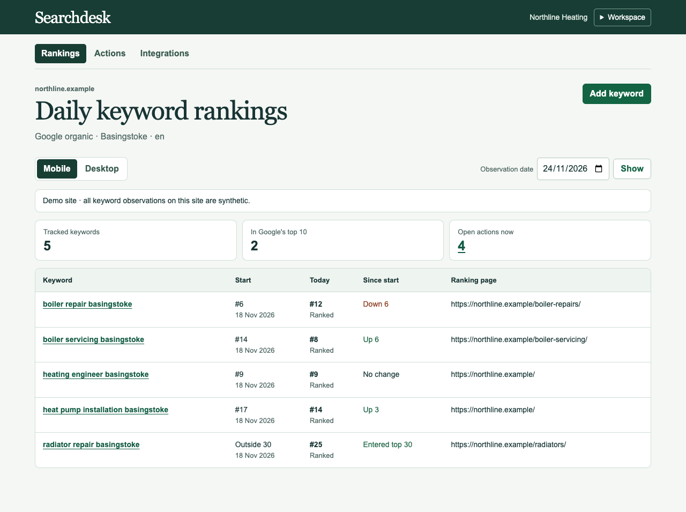

# Searchdesk

**An AI-assisted local SEO workspace built by [Devbox Technologies](https://devboxtech.co.uk/).**

Searchdesk brings local Google rankings, Search Console performance and Google Maps visibility into one workspace. Its AI assistant turns saved measurements into a brief with dated evidence and a next step the business owner can check.

Workspace owners can run scheduled local SEO workflows and download a private Local SEO Brain vault with weekly performance reports and saved Maps grids. [Workflow coverage and setup](docs/seo-workflows.md)

## Try the live demo

1. [Create a workspace](https://searchdesk.devboxtech.co.uk/signup), or [sign in](https://searchdesk.devboxtech.co.uk/login) if you already have an account.
2. On **Set up a site**, choose **Demo** under **Observation source** and leave the business fields blank to load the fictional Northline Heating site.
3. Open **Rankings** to compare desktop and mobile results. Then open **Actions** to see the measurements behind a recommendation and **Assistant** to review findings from the saved sample data.

The demo includes five fictional keywords and a week of sample history. The sample rankings and built-in reviews work without connecting a provider or entering an API key.

## Project example · Skin Hampshire

Devbox used Searchdesk to support SEO projects for Skin Hampshire. The workspace brings keyword tracking and search performance into the same review, so a team can check which page showed up for a search, see what changed and decide what to investigate. [Visit SkinHampshire.com](https://www.skinhampshire.com/)

## How the AI and skills work

Searchdesk supports suggested investigations and scheduled daily briefs. A business owner can ask which keyword action to review first, which tracked searches gained clicks, or how much of a sampled area ranked in the top three on Maps.

1. **Collect and compare.** Ruby on Rails and Solid Queue collect data from connected providers and retain its scope, dates and source. Rails calculates measurements such as ranking movement and click comparisons.
2. **Choose a review.** Versioned SEO playbooks match the question to the available evidence. They define which periods, devices or scan grids can be compared, which gaps to call out and what to check next.
3. **Validate the answer.** When OpenAI is enabled, the model selects saved evidence and a proposed check. Rails validates the references and links the findings back to their source. Workspace controls govern data sharing and model spend.

The demo shows the built-in review workflow. Model-generated questions and daily briefs require a configured OpenAI project, a workspace allowance and site consent. [Assistant design](docs/ai-assistant-plan.md) · [Versioned playbooks](config/assistant_playbooks/v1.yml)

### SEO project credits

| Project | What informed Searchdesk |
| --- | --- |
| [Local SEO Skills](https://github.com/garrettjsmith/localseoskills) by Garrett Smith / GMB Gorilla | Reporting guidance for like-for-like comparisons and practical follow-ups, plus keyword research guidance for choosing a preferred page. |
| [Local SEO Brain](https://github.com/AI-Marketing-Hub/local-seo-brain) by Daniel Agrici / AI Marketing Hub | Guidance on tying findings to dated evidence, identifying missing inputs and proposing a next check. |
| [Claude SEO](https://github.com/AgriciDaniel/claude-seo) by Daniel Agrici | On-page review guidance that informed title and heading checks. |

See the [SEO skills and attribution guide](docs/skills.md) for exact upstream revisions and the applicable licence notices.

## Built by Devbox Technologies

Devbox builds custom software and AI workflows that connect to the tools a business already uses. Searchdesk shows how we combine provider integrations, background processing and an AI interface that lets people inspect the evidence behind a recommendation. [Discuss an AI or software project with Devbox](https://devboxtech.co.uk/contact/)

## Technical documentation

Searchdesk uses Ruby on Rails, PostgreSQL and Solid Queue. The [integration guide](docs/connections.md) covers Google Search Console, GA4, Local Falcon, DataForSEO, OpenAI and account email. The [development handoff](docs/HANDOFF.md) maps the features to their implementation and acceptance tests. See the [hosting guide](docs/hosting.md) for operator setup.

## Licensing

All rights reserved for original Searchdesk material. Viewing the source grants no licence to use, modify or redistribute it. Bundled third-party material carries its own notices. [SEO playbook notices](docs/skills.md) · [Solid Queue notice](docs/Solid-Queue-LICENSE.txt) · [DM Sans notice](public/fonts/DM-Sans-LICENSE.txt)
